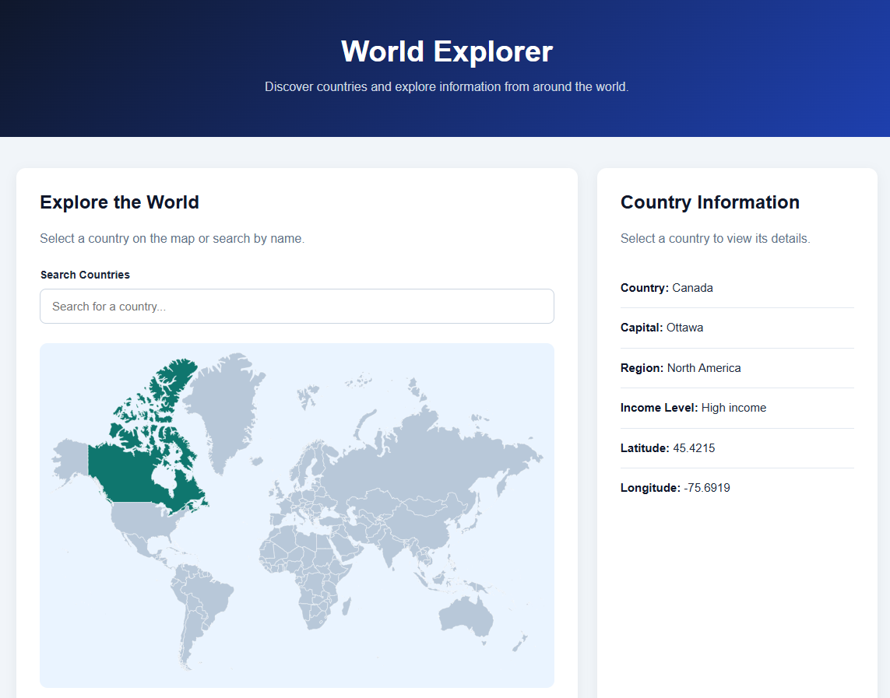

# Interactive World Map — World Explorer

**Angular 22 | TypeScript | REST API | HTML | CSS**

World Explorer is an interactive web application I built using Angular and TypeScript. It allows users to explore countries through a clickable world map or search for them by name.

The application retrieves country information from the World Bank API, including capital cities, regions, income levels, and geographic coordinates.

## Application Screenshot

## Problem

Finding information about different countries often involves searching for each country individually.

I wanted to build an application that brings country information together in one place and makes it easier to explore through an interactive map.

## Solution

I developed a responsive Angular application that uses an SVG world map and the World Bank REST API.

Users can select a country directly from the map or search for one by name. Once selected, the application retrieves the country's information and displays it alongside the map.

I also implemented country highlighting, loading indicators, and error handling to improve the user experience.

## Features

- **Interactive World Map:** Select countries by clicking on the map.
- **Country Search:** Search for countries by name and select matching results.
- **World Bank API Integration:** Retrieve information from an external API.
- **Country Information:** Display capitals, regions, income classifications, and coordinates.
- **Country Highlighting:** Visually identify hovered and selected countries.
- **Responsive Design:** Adjust the layout for different screen sizes.
- **Error Handling:** Display messages when API requests fail or information is unavailable.
- **Keyboard Support:** Select countries using Enter or Space.

## Technologies Used

| Technology | Purpose |
|---|---|
| Angular 22 | Frontend framework |
| TypeScript | Application logic |
| HTML & CSS | Interface and responsive styling |
| World Bank REST API | Country information |
| RxJS | Handling HTTP request timeouts |
| @svg-maps/world | Geographic SVG map data |

## How It Works

1. The application displays an interactive world map.
2. A user selects a country by clicking on the map or using the search bar.
3. Angular sends an HTTP request to the World Bank API.
4. The API returns the available country information.
5. The application displays the results in the Country Information panel.

I also implemented request handling to prevent older API responses from replacing information for a more recently selected country.

## Getting Started

To run this project locally, you'll need Node.js and npm installed.

**1. Clone the repository**

`git clone https://github.com/sancruz68/interactive-world-map.git`

**2. Open the project directory**

`cd interactive-world-map`

**3. Install dependencies**

`npm install`

**4. Start the development server**

`npm start`

**5. Open the application**

Navigate to `http://localhost:4200/` in your browser.

**Production build:**

`npm run build`

## Testing

I manually tested the following functionality:

- Searching for countries and selecting matching results.
- Selecting countries directly from the map.
- Displaying country information returned by the World Bank API.
- Handling searches with no matching countries.
- Checking the responsive layout at smaller browser sizes.

The Angular production build also completed successfully. Automated tests for the custom features have not yet been added.

## Current Limitations

- Country information depends on the availability of the World Bank API.
- Some countries and territories may not have complete information.
- The SVG geographic data contributes to a relatively large initial JavaScript bundle.

## Future Improvements

- Optimize the initial JavaScript bundle size.
- Add automated unit tests.
- Improve search accessibility and keyboard navigation.
- Deploy the application to make it publicly accessible.

## Data Sources and Attribution

**Country Information:** [World Bank API](https://datahelpdesk.worldbank.org/knowledgebase/articles/898590-country-api-queries)

**World Map:** [@svg-maps/world](https://github.com/VictorCazanave/svg-maps/tree/master/packages/world), based on map data originally from MapSVG.

The world map data is licensed under [Creative Commons Attribution 4.0 International (CC BY 4.0)](https://creativecommons.org/licenses/by/4.0/). This application adds custom styling, interactive country selection, search functionality, and API integration.